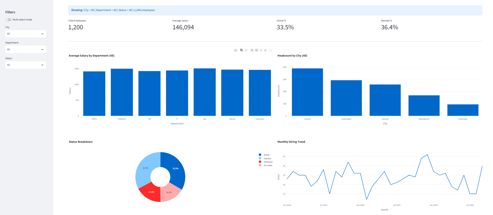

# Employee Data Cleaning & Dashboard

Cleaned and processed a messy HR dataset of 1,206 rows to build an interactive dashboard.

**Live demo:** https://employee-dashboard-sultan.streamlit.app

## Problem
"Cleaned a messy raw dataset by resolving inconsistent city names (LHR/lahore/Lahore), standardizing three different date formats, handling hidden missing values ('unknown', 'not available', 'invalid-date'), removing duplicates, and fixing inconsistent spellings in the Gender and Status columns."

## What I did
- Text standardization (City, Department, Gender, Status)
- Hidden missing values detect karke NaN me convert kiye
- 3 date formats parse kiye, 4 duplicate rows hataye
- Missing values ka documented strategy (flag columns + "Unknown")
- Streamlit dashboard: KPIs, filters, salary / headcount / hiring trend charts

## Tech
Python, Pandas, Plotly, Streamlit

## Run locally
pip install -r requirements.txt
python clean.py
streamlit run dashboard.py
